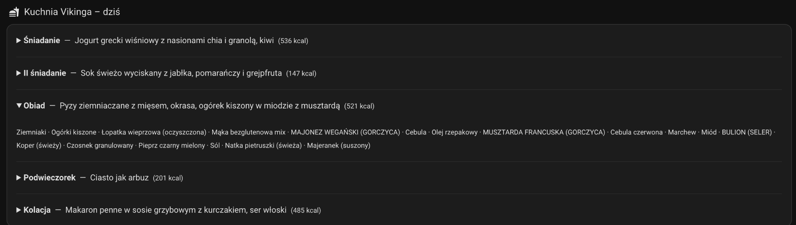

# Kuchnia Vikinga for Home Assistant

[](https://github.com/UrbanskiDawid/home-assistant-tauron-elicznik-kuchnia-vikinga/releases)
[](https://github.com/UrbanskiDawid/home-assistant-tauron-elicznik-kuchnia-vikinga/actions/workflows/test.yaml)
[](https://github.com/UrbanskiDawid/home-assistant-tauron-elicznik-kuchnia-vikinga/actions/workflows/hacs.yaml)
[](https://github.com/UrbanskiDawid/home-assistant-tauron-elicznik-kuchnia-vikinga/actions/workflows/hassfest.yaml)
[](https://hacs.xyz/)
[](LICENSE)

A minimal custom integration that shows today's [Kuchnia Vikinga](https://panel.kuchniavikinga.pl)
meals in Home Assistant: each dish's name, kcal and ingredients.



## Installation

### Using [HACS](https://hacs.xyz/) (recommended)

[](https://my.home-assistant.io/redirect/hacs_repository/?owner=UrbanskiDawid&repository=home-assistant-tauron-elicznik-kuchnia-vikinga&category=integration)

Click the button above, or add it by hand:

* In HACS open the ⋮ menu → _Custom repositories_
* Add `https://github.com/UrbanskiDawid/home-assistant-tauron-elicznik-kuchnia-vikinga` with type _Integration_
* Search for "Kuchnia Vikinga" and click _Download_
* Restart Home Assistant

HACS not installed yet? Follow the [HACS download guide](https://hacs.xyz/docs/use/download/download/) first.

### Manual

Download [*kuchnia_vikinga.zip*](https://github.com/UrbanskiDawid/home-assistant-tauron-elicznik-kuchnia-vikinga/releases/latest/download/kuchnia_vikinga.zip) and extract it to `config/custom_components/kuchnia_vikinga`:
```bash
mkdir -p /config/custom_components/kuchnia_vikinga
cd /config/custom_components/kuchnia_vikinga
wget https://github.com/UrbanskiDawid/home-assistant-tauron-elicznik-kuchnia-vikinga/releases/latest/download/kuchnia_vikinga.zip
unzip kuchnia_vikinga.zip
rm kuchnia_vikinga.zip
```

Then restart Home Assistant.

## Set up

1. Settings → Devices & services → Add integration → **Kuchnia Vikinga**.
2. Enter your panel.kuchniavikinga.pl e-mail and password.

   

This creates one sensor, `sensor.kuchnia_vikinga_dzisiaj`:
- **state**: the number of meals delivered today (0 if there is no delivery)
- **attributes**: `date`, and `meals` as a list of `{meal, name, kcal, ingredients}`

The panel is asked **once a day**. After a successful fetch it isn't contacted again until the next day. If a fetch fails, it retries at 5 minutes past each hour.

## Dashboard card

A full-width section (sections view) with one collapsible row per meal. Ingredients stay hidden until you click a meal.
Edit dashboard → ⋮ → *Raw configuration editor* → paste it into the view's `sections:` list:

```yaml
type: grid
column_span: 4
cards:
  - type: heading
    heading: Kuchnia Vikinga – dziś
    icon: mdi:food
  - type: markdown
    grid_options:
      columns: full
    content: |-
      
      
      <details>
      <summary><b>{{ m.meal }}</b> &nbsp;—&nbsp; {{ m.name }} &nbsp;<small>({{ m.kcal }} kcal)</small></summary>
      <br><small>{{ m.ingredients | join(' · ') }}</small>
      </details>
      <hr>
      
      <i>Brak dostawy dzisiaj.</i>
      
```

The integration icon (`brand/icon.png`) is shown by Home Assistant 2026.3 or newer.

## Development

```sh
pip install -r requirements_test.txt
pytest
```

To release, push a tag: `git tag v0.1.0 && git push origin v0.1.0`. The workflow sets the manifest version from the tag and attaches `kuchnia_vikinga.zip` to the release.

## License

[MIT](LICENSE)

Unofficial; not affiliated with Kuchnia Vikinga. Uses the same endpoints as the customer panel.
