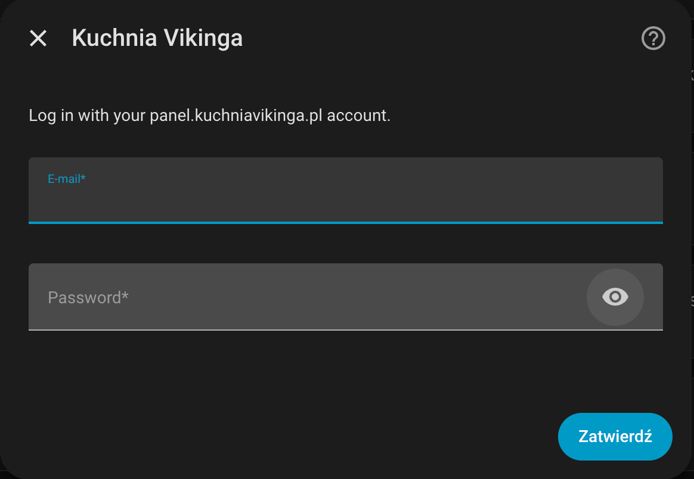

# Kuchnia Vikinga dla Home Assistant

[](https://github.com/UrbanskiDawid/home-assistant-kuchnia-vikinga/releases)
[](https://github.com/UrbanskiDawid/home-assistant-kuchnia-vikinga/actions/workflows/test.yaml)
[](https://github.com/UrbanskiDawid/home-assistant-kuchnia-vikinga/actions/workflows/hacs.yaml)
[](https://github.com/UrbanskiDawid/home-assistant-kuchnia-vikinga/actions/workflows/hassfest.yaml)
[](https://hacs.xyz/)
[](LICENSE)

Prosta integracja, która pokazuje w Home Assistant dzisiejsze posiłki z cateringu dietetycznego
[Kuchnia Vikinga](https://kuchniavikinga.pl/): nazwę każdego dania, kaloryczność i składniki.
Dane pobiera z Twojego konta w [panelu klienta](https://panel.kuchniavikinga.pl).

> [!NOTE]
> To **nieoficjalny** projekt społecznościowy. Nie jest powiązany z firmą
> [Kuchnia Vikinga](https://kuchniavikinga.pl/), nie jest przez nią wspierany ani zatwierdzony.
> Nie kontaktuj się z nimi w jego sprawie, zamiast tego
> [zgłoś problem](https://github.com/UrbanskiDawid/home-assistant-kuchnia-vikinga/issues) tutaj.


## Instalacja

### Przez [HACS](https://hacs.xyz/) (zalecane)

[](https://my.home-assistant.io/redirect/hacs_repository/?owner=UrbanskiDawid&repository=home-assistant-kuchnia-vikinga&category=integration)

Kliknij przycisk powyżej albo dodaj repozytorium ręcznie:

* W HACS otwórz menu ⋮ → _Niestandardowe repozytoria_ (_Custom repositories_)
* Dodaj `https://github.com/UrbanskiDawid/home-assistant-kuchnia-vikinga` z typem _Integracja_ (_Integration_)
* Wyszukaj „Kuchnia Vikinga” i kliknij _Pobierz_
* Uruchom ponownie Home Assistant

Nie masz jeszcze HACS? Najpierw zainstaluj go według [instrukcji HACS](https://hacs.xyz/docs/use/download/download/).

### Ręcznie

Pobierz [*kuchnia_vikinga.zip*](https://github.com/UrbanskiDawid/home-assistant-kuchnia-vikinga/releases/latest/download/kuchnia_vikinga.zip) i rozpakuj do `config/custom_components/kuchnia_vikinga`:
```bash
mkdir -p /config/custom_components/kuchnia_vikinga
cd /config/custom_components/kuchnia_vikinga
wget https://github.com/UrbanskiDawid/home-assistant-kuchnia-vikinga/releases/latest/download/kuchnia_vikinga.zip
unzip kuchnia_vikinga.zip
rm kuchnia_vikinga.zip
```

Następnie uruchom ponownie Home Assistant.

## Konfiguracja

1. Ustawienia → Urządzenia oraz usługi → Dodaj integrację → **Kuchnia Vikinga**.
2. Podaj e-mail i hasło do panel.kuchniavikinga.pl.

   

Integracja tworzy jeden sensor, `sensor.kuchnia_vikinga_dzisiaj`:
- **stan**: liczba posiłków dostarczonych dzisiaj (0, jeśli nie ma dostawy)
- **atrybuty**: `date` oraz `meals`, czyli lista `{meal, name, kcal, ingredients, vote}`

Panel jest odpytywany **raz dziennie**. Po udanym pobraniu integracja nie łączy się z nim aż do
następnego dnia. Jeśli pobranie się nie uda, ponawia próbę 5 minut po każdej pełnej godzinie.

## Karta na dashboard

Integracja zawiera własną kartę, nie trzeba niczego doinstalowywać. Każdy posiłek ma po lewej
stronie przyciski 👍/👎, a po kliknięciu nazwy rozwijają się składniki. Ponowne kliknięcie
aktywnego kciuka usuwa ocenę.

Edytuj dashboard → *Dodaj kartę* → wyszukaj **Kuchnia Vikinga** albo wklej w edytorze YAML:

```yaml
type: custom:kuchnia-vikinga-card
```

Opcjonalnie: `entity` (domyślnie `sensor.kuchnia_vikinga_dzisiaj`) i `title`.

## Oceny

Oceny są zapisywane lokalnie w Home Assistant (`.storage/kuchnia_vikinga.votes`) według nazwy
dania, więc to samo danie w kolejnych dniach ma już Twoją ocenę. Każdy posiłek w atrybucie
`meals` ma pole `vote` (`up`, `down` albo puste).

Ocenę można też ustawić usługą, np. w automatyzacji:

```yaml
action: kuchnia_vikinga.vote
data:
  name: Zupa pomidorowa
  vote: up   # up, down albo none
```

Ikona integracji (`brand/icon.png`) jest widoczna w Home Assistant 2026.3 i nowszych.

## Licencja

Projekt jest udostępniony na [licencji MIT](LICENSE).

## Zastrzeżenie

Projekt nieoficjalny, niepowiązany z firmą [Kuchnia Vikinga](https://kuchniavikinga.pl/). Nazwa
„Kuchnia Vikinga” służy wyłącznie do wskazania usługi, z którą współpracuje integracja. Integracja
korzysta z tych samych adresów co [panel klienta](https://panel.kuchniavikinga.pl), które mogą się
zmienić w dowolnym momencie bez uprzedzenia.
